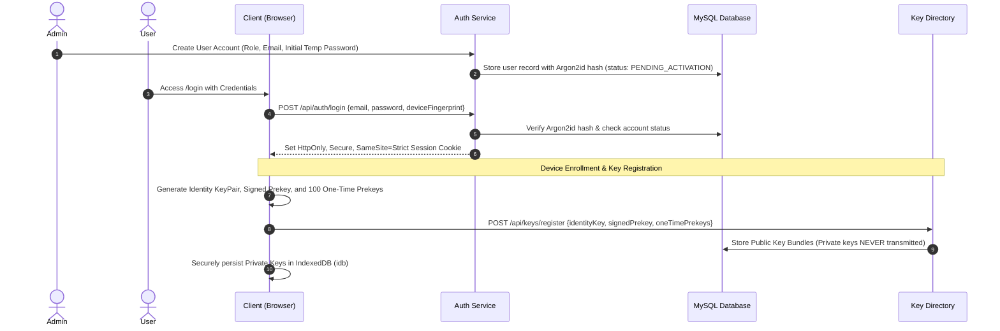
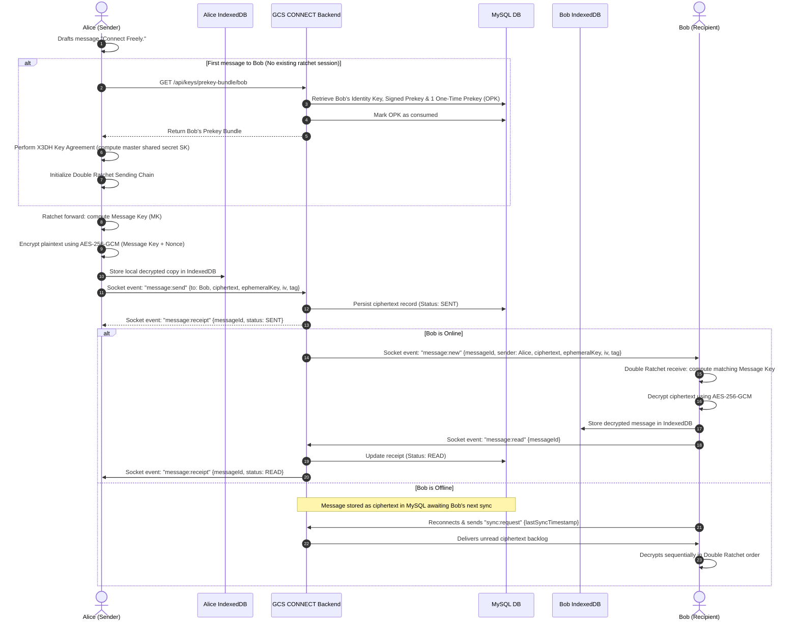
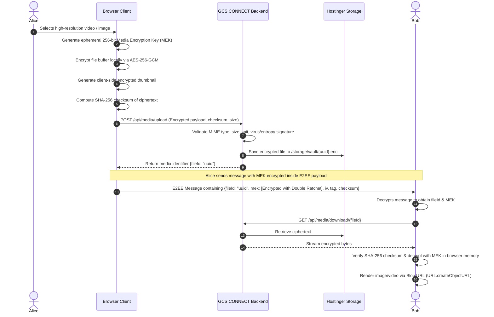
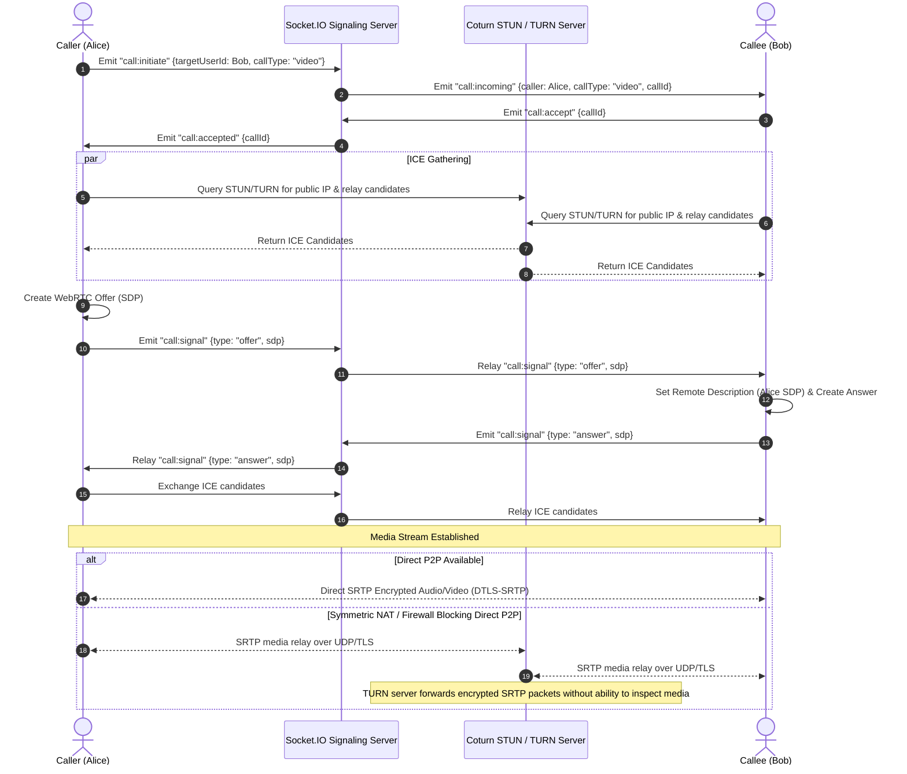
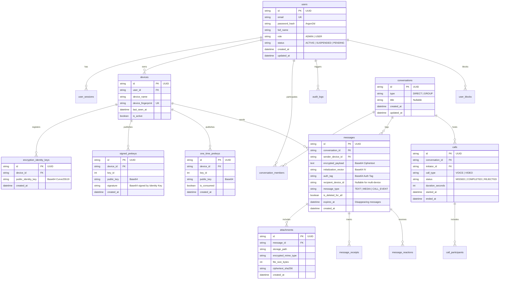

# GCS CONNECT — System Architecture & Design Specification
**Document Version:** 1.0.0  
**Phase:** 0 & 1 — System Architecture  
**Author:** Principal Software Architect & Cryptography Lead, Global Crest Solutions  
**Date:** November 2, 2026  
**Status:** APPROVED & BASELINED  

---

## 1. System Vision & Design Philosophy

**GCS CONNECT** is built on a fundamental security principle:  
> **The server is an untrusted courier.**  
> The backend handles routing, delivery, authentication, and signaling, but it **never possesses the cryptographic keys to read messages, view media, or decrypt audio/video call streams.**

### 1.1 Architectural Principles
1. **Zero-Knowledge Core:** Plaintext messages and media never leave the user's browser unencrypted.
2. **Device-Centric Identity:** Cryptographic identity is bound to physical devices, not usernames or passwords.
3. **Decoupled Real-time & Presentation:** Next.js powers the responsive client UI, while an Express + Socket.IO server manages authenticated real-time pipelines and WebRTC signaling.
4. **Resilient Offline Sync:** Full message ratchet state and message history reside client-side in encrypted `IndexedDB`.
5. **Auditable & Verifiable:** Cryptographic operations adhere strictly to published test vectors and open standards (Web Crypto API, X3DH, Double Ratchet).

---

## 2. High-Level Component Architecture

```mermaid
flowchart TD
    subgraph ClientBrowser["Client Web Browser (Desktop / Mobile)"]
        UI["Next.js UI Layer (Tailwind / Black & Emerald)"]
        CryptoEngine["Cryptographic Engine (Web Crypto / X3DH / Double Ratchet)"]
        LocalStore["Local Encrypted Vault (IndexedDB - idb)"]
        SocketClient["Socket.IO Client (WSS)"]
        WebRTCClient["WebRTC Media Engine (getUserMedia / RTCPeerConnection)"]
        
        UI <--> CryptoEngine
        CryptoEngine <--> LocalStore
        UI <--> SocketClient
        UI <--> WebRTCClient
    end

    subgraph EdgeLayer["Edge / Network Layer (Hostinger)"]
        Nginx["Nginx Reverse Proxy (TLS 1.3 / WSS Termination)"]
    end

    subgraph BackendServices["Backend Application Services (Node.js 20 LTS)"]
        AuthService["Auth & Device Service (Argon2id, Session Registry)"]
        KeyService["E2EE Key Directory (Identity, Signed & One-Time Prekeys)"]
        MessageRouter["Message Broker & Delivery Router (Socket.IO Engine)"]
        MediaService["Encrypted Media Vault Service (Chunked Ingestion)"]
        SignalingService["WebRTC Signaling Hub (SDP / ICE Exchange)"]
        AdminService["Admin Audit & Compliance Engine"]
    end

    subgraph DataTier["Data Tier"]
        MySQL[("MySQL 8+ Production Database (Prisma ORM)")]
        EncryptedStorage[("Hostinger Encrypted Media Storage")]
    end

    subgraph NATTraversal["NAT Traversal Infrastructure"]
        Coturn["Coturn STUN / TURN Relay (Dedicated VPS / Managed)"]
    end

    SocketClient <-->|WSS via Nginx| Nginx
    UI <-->|HTTPS via Nginx| Nginx
    WebRTCClient <-->|ICE Gathering / Media Relay| Coturn
    WebRTCClient <-->|SRTP Media Stream (Direct P2P)| WebRTCClient

    Nginx <--> AuthService
    Nginx <--> KeyService
    Nginx <--> MessageRouter
    Nginx <--> MediaService
    Nginx <--> SignalingService
    Nginx <--> AdminService

    AuthService --> MySQL
    KeyService --> MySQL
    MessageRouter --> MySQL
    MediaService --> MySQL
    MediaService --> EncryptedStorage
    AdminService --> MySQL
```

---

## 3. Core Data & Security Flows

### 3.1 Authentication & Device Session Lifecycle

Only system administrators can create accounts. Once created, a user is invited or given activation credentials.



---

### 3.2 End-to-End Encrypted Messaging (X3DH + Double Ratchet)



---

### 3.3 Client-Side Encrypted Media Pipeline

Plaintext images, videos, audio notes, and files are **never** uploaded directly.



---

### 3.4 WebRTC 1-to-1 Voice & Video Calling Architecture



---

## 4. Database Entity Relationships (ERD)



---

## 5. Official Black & Emerald Design System Specifications

The visual design system must enforce brand consistency across all viewports:

| Token Name | Hex Code | Visual Application |
| :--- | :--- | :--- |
| **`bg-primary`** | `#121816` | Main window background, global application canvas |
| **`accent-emerald`** | `#00A879` | Primary CTA buttons, active tabs, unread badges, sent checkmarks |
| **`pale-mint`** | `#B6F1D9` | Emerald hover highlights, subtle focus rings, badge text |
| **`surface-secondary`** | `#E9EFEC` | Light contrast elements, modal headers (light mode fallback) |
| **`card-bg`** | `#1C2420` | Message containers, dropdown menus, search inputs, modal cards |
| **`sidebar-bg`** | `#151D19` | Left chat list navigation, contact details drawer, admin sidebar |
| **`msg-received`** | `#25372E` | Incoming message bubble background |
| **`msg-sent`** | `#205B45` | Outgoing message bubble background |
| **`text-main`** | `#F0F5F1` | Primary headings, active contact names, message text |
| **`text-secondary`**| `#A4B5AA` | Timestamps, status text, preview snippets, unread indicators |
| **`border-emerald`** | `#31463A` | Subtle dividers, card borders, active input borders |
| **`status-error`** | `#D94D55` | Call disconnect button, validation errors, destructive actions |
| **`status-warning`**| `#D99B31` | Security alerts, reconnecting toast, self-destructing countdowns |
