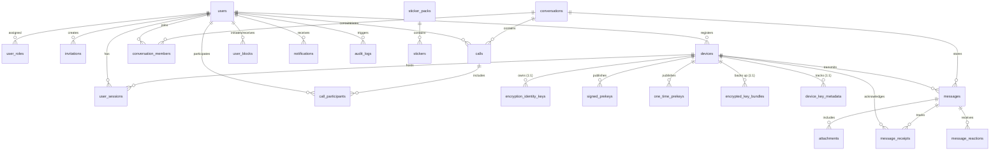

# GCS CONNECT — Database Schema Specification & Metadata Architecture
**Document Version:** 1.0.0  
**Phase:** 2 — Database Implementation  
**Database Engine:** MySQL 8+ / MariaDB 11 (InnoDB Engine, utf8mb4)  
**ORM:** Prisma ORM 5.22.0  
**Author:** Database Architect & Cryptography Lead, Global Crest Solutions  
**Date:** November 2, 2026  
**Status:** IMPLEMENTED, MIGRATED & VERIFIED  

---

## 1. Zero-Knowledge Cryptographic Boundary

In compliance with the mandatory security requirements of GCS CONNECT:
> **The database stores only public cryptographic keys, signed prekeys, one-time prekeys, and Base64-encoded ciphertext with its initialization vector and authentication tag.**  
> **Under no circumstances are plaintext message bodies, private identity keys, or media files stored in MySQL.**

### What the Server CAN See (Metadata):
* User account identifiers, email addresses, and Argon2id password hashes.
* Active devices bound to each user and their last-seen timestamp.
* Conversation membership records (who is in a chat room).
* Timestamp of message transmission, delivery, and read receipts.
* Ciphertext size, initialization vectors (12 bytes), and authentication tags (16 bytes).
* Public identity keys, signed prekeys, and one-time prekeys for X3DH key exchange.

### What the Server CANNOT See (Zero-Knowledge):
* ❌ Message content (plaintext is encrypted on sender device via Double Ratchet AES-256-GCM).
* ❌ Image, video, or audio content (files encrypted on client before upload).
* ❌ User private identity keys or private ratchet keys (stored strictly in client IndexedDB).
* ❌ Media encryption keys (MEKs are encrypted inside E2EE message payloads).

---

## 2. Entity Relational Architecture (22 Core Entities)



---

## 3. Data Dictionary

### 3.1 `users`
Primary account directory. Accounts are administrator-created or invited.
| Column | Type | Constraints | Description |
| :--- | :--- | :--- | :--- |
| `id` | `VARCHAR(36)` | `PRIMARY KEY` (UUID) | Public unique user identifier. |
| `email` | `VARCHAR(191)` | `UNIQUE, NOT NULL` | Verified corporate email address. |
| `password_hash` | `VARCHAR(255)` | `NOT NULL` | RFC 9106 Argon2id memory-hard password hash. |
| `full_name` | `VARCHAR(191)` | `NOT NULL` | User legal / display full name. |
| `display_name` | `VARCHAR(191)` | `NULL` | Optional chat nickname. |
| `avatar_url` | `VARCHAR(255)` | `NULL` | Public avatar image URL. |
| `status` | `VARCHAR(32)` | `DEFAULT 'ACTIVE'` | Account status: `ACTIVE`, `SUSPENDED`, `PENDING_ACTIVATION`, `DELETED`. |
| `is_two_factor_enabled` | `BOOLEAN` | `DEFAULT FALSE` | Flag for 2FA requirement. |
| `two_factor_secret` | `VARCHAR(255)` | `NULL` | Encrypted TOTP secret. |
| `created_at` | `DATETIME(3)` | `DEFAULT CURRENT_TIMESTAMP` | Account creation timestamp. |
| `updated_at` | `DATETIME(3)` | `AUTO-UPDATE` | Last modification timestamp. |
| `deleted_at` | `DATETIME(3)` | `NULL` | Soft deletion timestamp. |

---

### 3.2 `devices`
Physical browser and client devices enrolled by a user. E2EE identity is bound to devices.
| Column | Type | Constraints | Description |
| :--- | :--- | :--- | :--- |
| `id` | `VARCHAR(36)` | `PRIMARY KEY` (UUID) | Public unique device identifier. |
| `user_id` | `VARCHAR(36)` | `FOREIGN KEY (users.id) ON DELETE CASCADE` | Enrolling user account. |
| `device_name` | `VARCHAR(191)` | `NOT NULL` | Human-readable client label (e.g., "ThinkPad Chrome"). |
| `device_fingerprint`| `VARCHAR(191)` | `NOT NULL` | Unique device hardware/canvas fingerprint. |
| `client_platform` | `VARCHAR(64)` | `NULL` | Platform enum (`WEB_CHROME`, `WEB_SAFARI`, `MOBILE_WEB`). |
| `last_seen_at` | `DATETIME(3)` | `NOT NULL` | Presence timestamp. |
| `is_active` | `BOOLEAN` | `DEFAULT TRUE` | Active/revocation state. |

---

### 3.3 `encryption_identity_keys`
Curve25519 public identity key material for each enrolled device.
| Column | Type | Constraints | Description |
| :--- | :--- | :--- | :--- |
| `id` | `VARCHAR(36)` | `PRIMARY KEY` (UUID) | Record UUID. |
| `device_id` | `VARCHAR(36)` | `UNIQUE, FOREIGN KEY (devices.id) ON DELETE CASCADE` | Associated device. |
| `public_identity_key`| `TEXT` | `NOT NULL` | Base64-encoded public Identity Key ($IK$). |
| `key_algorithm` | `VARCHAR(32)` | `DEFAULT 'Curve25519'` | Cryptographic curve primitive. |

---

### 3.4 `signed_prekeys`
Medium-term signed prekeys ($SPK$) rotated periodically by the device.
| Column | Type | Constraints | Description |
| :--- | :--- | :--- | :--- |
| `id` | `VARCHAR(36)` | `PRIMARY KEY` (UUID) | Record UUID. |
| `device_id` | `VARCHAR(36)` | `FOREIGN KEY (devices.id) ON DELETE CASCADE` | Publishing device. |
| `key_id` | `INT` | `NOT NULL` | Integer index of the signed prekey. |
| `public_key` | `TEXT` | `NOT NULL` | Base64-encoded public signed prekey. |
| `signature` | `TEXT` | `NOT NULL` | Base64 signature of $SPK$ verified by $IK$. |
| `is_active` | `BOOLEAN` | `DEFAULT TRUE` | Whether currently valid for new sessions. |

---

### 3.5 `one_time_prekeys`
Pool of single-use ephemeral keys ($OPK$) consumed during X3DH session initiation.
| Column | Type | Constraints | Description |
| :--- | :--- | :--- | :--- |
| `id` | `VARCHAR(36)` | `PRIMARY KEY` (UUID) | Record UUID. |
| `device_id` | `VARCHAR(36)` | `FOREIGN KEY (devices.id) ON DELETE CASCADE` | Publishing device. |
| `key_id` | `INT` | `NOT NULL` | Integer index of the one-time prekey. |
| `public_key` | `TEXT` | `NOT NULL` | Base64 public one-time prekey. |
| `is_consumed` | `BOOLEAN` | `DEFAULT FALSE` | True if consumed by an X3DH exchange. |
| `consumed_at` | `DATETIME(3)` | `NULL` | Timestamp when consumed. |

---

### 3.6 `messages`
Ciphertext message repository. Stores no plaintext.
| Column | Type | Constraints | Description |
| :--- | :--- | :--- | :--- |
| `id` | `VARCHAR(36)` | `PRIMARY KEY` (UUID) | Public message UUID. |
| `conversation_id` | `VARCHAR(36)` | `FOREIGN KEY (conversations.id) ON DELETE CASCADE` | Target conversation. |
| `sender_device_id` | `VARCHAR(36)` | `FOREIGN KEY (devices.id) ON DELETE CASCADE` | Transmitting device. |
| `recipient_device_id`| `VARCHAR(36)` | `NULL, FOREIGN KEY (devices.id) ON DELETE SET NULL` | Target device. |
| `message_type` | `VARCHAR(32)` | `DEFAULT 'TEXT'` | `TEXT`, `IMAGE`, `VIDEO`, `AUDIO`, `DOCUMENT`, `STICKER`. |
| `encrypted_payload` | `LONGTEXT` | `NOT NULL` | Base64 AES-256-GCM ciphertext payload. |
| `initialization_vector`| `VARCHAR(64)` | `NOT NULL` | Base64 12-byte (96-bit) unique nonce. |
| `auth_tag` | `VARCHAR(64)` | `NOT NULL` | Base64 16-byte (128-bit) GCM authentication tag. |
| `ephemeral_key` | `TEXT` | `NULL` | Base64 public ratchet key for DH ratchet step. |
| `ratchet_sequence_number`| `INT` | `DEFAULT 0` | Message index in sending ratchet chain. |
| `is_deleted_for_everyone`| `BOOLEAN`| `DEFAULT FALSE` | Remote deletion marker. |
| `expires_at` | `DATETIME(3)` | `NULL` | TTL timestamp for disappearing messages. |
| `created_at` | `DATETIME(3)` | `DEFAULT CURRENT_TIMESTAMP` | Ingestion timestamp. |

---

## 4. Database Backup & Disaster Recovery Procedures

### 4.1 Automated Daily Backup Script (`backup-db.sh`)
```bash
#!/bin/bash
# GCS CONNECT — MySQL Hot Backup Script
BACKUP_DIR="/home/u797749929/backups/mysql"
DATE=$(date +%Y%m%d_%H%M%S)
mkdir -p "$BACKUP_DIR"

mysqldump --single-transaction --quick --lock-tables=false \
  -h srv1573.hstgr.io -u u797749929_gcsuser -p"$DB_PASS" u797749929_GCS \
  | gzip > "$BACKUP_DIR/gcs_connect_backup_$DATE.sql.gz"

# Retain 30 days of rolling backups
find "$BACKUP_DIR" -type f -name "*.sql.gz" -mtime +30 -delete
```

### 4.2 Point-in-Time Recovery Procedure
1. Halt write operations or place application in maintenance mode.
2. Unpack target backup file:
   ```bash
   gunzip < gcs_connect_backup_20261102.sql.gz | mysql -h srv1573.hstgr.io -u u797749929_gcsuser -p u797749929_GCS
   ```
3. Re-run `npx prisma migrate deploy` to ensure schema consistency.
4. Verify record integrity with `src/lib/db.test.ts`.
