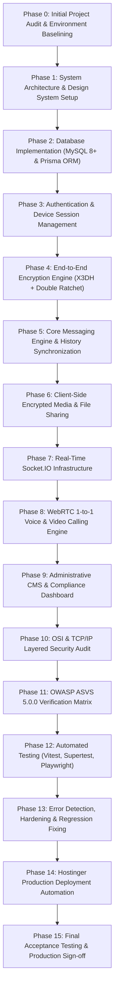

# GCS CONNECT — Engineering Development Roadmap & Execution Plan
**Document Version:** 1.0.0  
**Phase:** 0 — Initial Project Audit  
**Author:** Principal Software Architect & DevOps Lead, Global Crest Solutions  
**Date:** November 2, 2026  
**Status:** APPROVED & BASELINED  

---

## 1. Master Phase Overview

Development follows a strict phase-by-phase sequential lifecycle. No phase is marked complete without automated test evidence and security verification.

---

## 2. Phase-by-Phase Deliverables & Acceptance Criteria

### Phase 0 — Initial Project Audit *(Current Phase)*
* **Objective:** Audit workspace, dependencies, hosting, compilers, databases, and cryptographic feasibility.
* **Deliverables:** `PROJECT_AUDIT.md`, `ARCHITECTURE.md`, `TECH_STACK.md`, `SECURITY_REQUIREMENTS.md`, `THREAT_MODEL.md`, `DEVELOPMENT_ROADMAP.md`, `DEVELOPMENT_STATUS.md`.
* **Exit Criteria:** Complete environment baseline; clear architectural consensus; zero destructive actions.

### Phase 1 — System Architecture & Design System Setup
* **Objective:** Establish the project scaffolding (Next.js + Express backend), TypeScript configuration, Tailwind design system tokens, and reusable UI components.
* **Deliverables:**
  - `package.json` with hardened dependencies.
  - Tailwind Black & Emerald theme configuration (`tailwind.config.js`).
  - Reusable UI component library (Button, Modal, Avatar, Input, Badge, Toast, Drawer).
  - Clean API routes and healthcheck endpoints.
* **Exit Criteria:** Responsive UI component gallery renders cleanly in Chromium; zero lint/TypeScript errors.

### Phase 2 — Database Implementation (MySQL 8+ & Prisma ORM)
* **Objective:** Define and migrate the normalized relational schema in MySQL 8+.
* **Deliverables:**
  - `prisma/schema.prisma` containing all 22 required entities.
  - Migration scripts with foreign keys, indexes, unique constraints, and enum types.
  - Automated database seed script (`prisma/seed.ts`) with default admin account.
* **Exit Criteria:** Prisma migration succeeds against MySQL; transaction and cascade deletion tests pass.

### Phase 3 — Authentication & Administration
* **Objective:** Implement administrator-managed account creation, Argon2id hashing, secure HttpOnly sessions, and multi-device session revocation.
* **Deliverables:**
  - Admin account creation and invitation flow.
  - User login/logout with device fingerprinting and rate limiting.
  - Session revocation and account suspension middleware.
* **Exit Criteria:** Integration tests confirm unauthenticated access is blocked; admin cannot impersonate users.

### Phase 4 — End-to-End Encryption Engine
* **Objective:** Implement native client-side X3DH key agreement and Double Ratchet authenticated encryption.
* **Deliverables:**
  - Key generation module (Identity Keys, Signed Prekeys, One-Time Prekeys).
  - Prekey bundle distribution API.
  - Client-side Double Ratchet encryption/decryption module in Web Crypto API.
  - Local state persistence in browser `IndexedDB`.
* **Exit Criteria:** Cryptographic test vectors pass; server receives only base64 ciphertext; modified ciphertext fails decryption.

### Phase 5 — Core Messaging System
* **Objective:** Implement 1-to-1 conversations, message history, receipts, editing, deletion (delete for me / delete for all), disappearing messages, and offline sync.
* **Deliverables:**
  - Conversation service and REST API endpoints.
  - Client-side message dispatcher and decryptor.
  - Disappearing messages worker.
* **Exit Criteria:** Two browser sessions send, receive, and decrypt messages in real time with correct delivery/read receipts.

### Phase 6 — Client-Side Encrypted Media & File Sharing
* **Objective:** Securely share images, videos, audio notes, and documents.
* **Deliverables:**
  - Client-side AES-256-GCM file encryption/decryption buffer pipeline.
  - Encrypted thumbnail generation.
  - Chunked file upload and download endpoints.
  - In-browser media renderer (voice player, video player, image lightbox).
* **Exit Criteria:** Encrypted file uploads succeed; server storage holds only ciphertext; unauthorized access is blocked.

### Phase 7 — Real-Time Socket.IO Infrastructure
* **Objective:** Authenticated real-time event distribution for messages, presence, typing indicators, and call signaling.
* **Deliverables:**
  - Socket.IO server with JWT handshake authentication.
  - Room authorization and rate limiting.
  - Typing indicator and online/offline presence tracker.
* **Exit Criteria:** Socket connects securely; reconnects without state loss; unauthorized room joins rejected.

### Phase 8 — WebRTC 1-to-1 Voice & Video Calling
* **Objective:** Browser-to-browser voice and video calling with STUN/TURN fallback.
* **Deliverables:**
  - WebRTC connection manager (`RTCPeerConnection`).
  - Socket.IO signaling handlers (`offer`, `answer`, `ice-candidate`).
  - Active call UI with microphone mute, camera toggle, and duration counter.
* **Exit Criteria:** Successful 1-to-1 audio/video call between two separate browser contexts over STUN/TURN.

### Phase 9 — Administrative CMS & Compliance Dashboard
* **Objective:** Protected admin dashboard for user management, session oversight, storage auditing, and sticker pack configuration.
* **Deliverables:**
  - Admin metrics dashboard.
  - User account management table (create, suspend, revoke sessions).
  - Audit log viewer.
* **Exit Criteria:** Admin dashboard renders cleanly; admin cannot view or decrypt message plaintext.

### Phase 10 — OSI & TCP/IP Layered Security Audit
* **Objective:** Complete 7-layer OSI and 4-layer TCP/IP verification against physical, network, transport, and application risks.
* **Deliverables:** `SECURITY_TEST_REPORT.md` mapping controls across all layers.

### Phase 11 — OWASP ASVS 5.0.0 Verification Matrix
* **Objective:** ASVS Level 2 compliance verification and STRIDE threat model audit.
* **Deliverables:** `ASVS_CHECKLIST.md` with requirement IDs, test cases, and pass/fail evidence.

### Phase 12 — Automated Testing & Test Automation
* **Objective:** Comprehensive unit, integration, and Playwright end-to-end multi-user test suites.
* **Deliverables:** Full automated test suite passing with high coverage.

### Phase 13 — Error Detection, Hardening & Regression Fixing
* **Objective:** Static analysis, linting, memory leak profiling, and dependency vulnerability patching.
* **Deliverables:** Clean build, zero warnings, zero known high/critical CVEs.

### Phase 14 — Hostinger Production Deployment Automation
* **Objective:** Production build packaging, environment variable templates, and PM2 deployment scripts.
* **Deliverables:** `DEPLOYMENT_GUIDE.md`, deployment bundle, and database migration runner.

### Phase 15 — Final Acceptance Testing & Production Sign-Off
* **Objective:** Demonstration of all 35 acceptance checklist items.
* **Deliverables:** Production sign-off report and release notes.
