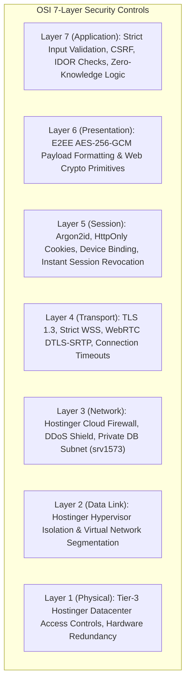
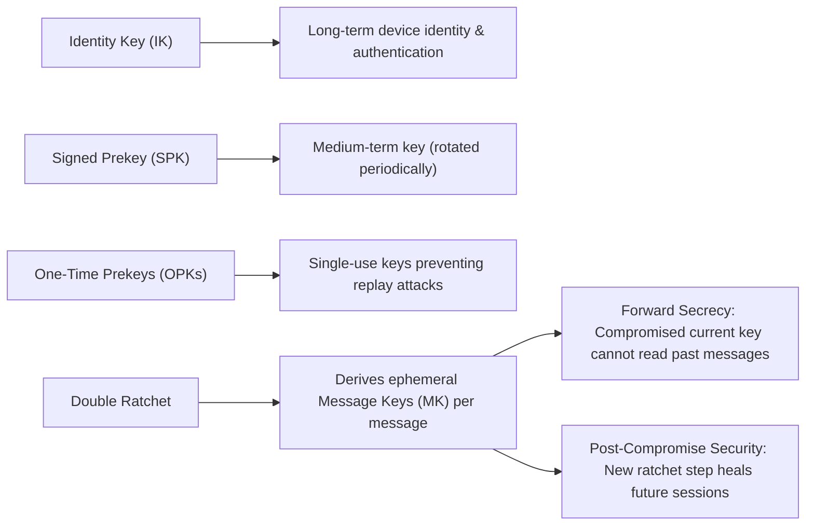

# GCS CONNECT — Security Requirements & Compliance Specification
**Document Version:** 1.0.0  
**Baseline Standard:** OWASP ASVS 5.0.0 & OWASP Cheat Sheet Series  
**Author:** Cybersecurity & Application Security Lead, Global Crest Solutions  
**Date:** November 2, 2026  
**Status:** APPROVED & BASELINED  

---

## 1. Security Baseline & Governance

GCS CONNECT adheres strictly to **OWASP Application Security Verification Standard (ASVS) Level 2 (Standard Enterprise Applications with Sensitive Data)** and relevant sections of Level 3 (Advanced Encryption & Integrity).

---

## 2. OSI & TCP/IP Layered Security Architecture

Security is enforced defense-in-depth across the network and application stack:

### 2.1 OSI Layer 1 — Physical
- **Hostinger Infrastructure:** Multi-tier datacenter biometric access controls, dual-source power, hardware redundancy.
- **Scope Limit:** Application code cannot control physical hardware; reliance is placed on verified SOC 2 / ISO 27001 hosting certifications.

### 2.2 OSI Layer 2 — Data Link
- **Network Segmentation:** CloudLinux container isolation prevents memory bleeding and ARP spoofing across tenant accounts on Hostinger nodes.

### 2.3 OSI Layer 3 — Network (TCP/IP: Network Access / Internet)
- **Firewall & Rate Limiting:** Hostinger edge protection blocks volumetric UDP/TCP floods.
- **Database Boundary:** Remote MySQL (`srv1573.hstgr.io`) restricted via IP whitelisting.
- **Coturn Boundary:** TURN server protected against traffic reflection attacks using authorized short-term REST credentials.

### 2.4 OSI Layer 4 — Transport (TCP/IP: Transport)
- **Encryption in Transit:** All HTTP traffic redirected to HTTPS; all WebSocket traffic over WSS.
- **TLS Configuration:** Minimum TLS 1.2, preferred TLS 1.3 with forward-secret cipher suites (ECDHE-ECDSA-AES256-GCM-SHA384).
- **WebRTC Transport:** Mandatory DTLS-SRTP encryption for audio/video media streams.

### 2.5 OSI Layer 5 — Session (TCP/IP: Application)
- **Device-Bound Sessions:** Session tokens stored strictly in `HttpOnly`, `Secure`, `SameSite=Strict` cookies.
- **Session Revocation:** Server maintains an active device session registry in MySQL. Immediate revocation on logout or admin intervention.
- **WebSocket Handshake Auth:** Socket.IO connections authenticated during initial HTTP upgrade; unauthorized sockets rejected before room joining.

### 2.6 OSI Layer 6 — Presentation (TCP/IP: Application)
- **End-to-End Encryption:** Messages, attachments, and call signals serialized and encrypted client-side using Web Crypto standard primitives.
- **Encoding & Sanitization:** Unicode normalization, strict JSON schema validation, and zero execution of uploaded binary blobs.

### 2.7 OSI Layer 7 — Application (TCP/IP: Application)
- **OWASP ASVS Verification:** Comprehensive enforcement of access controls, zero SQL injection via Prisma ORM parameterized queries, zero XSS via React JSX auto-escaping, and strict Content-Security-Policy (CSP).

---

## 3. Cryptographic Requirements & Threat Guarantees

### 3.1 Non-Negotiable Cryptographic Rules
1. **Zero Plaintext on Server:** The server database must **never** receive or store plaintext message bodies, media files, or private keys.
2. **No Custom Cryptography:** All cryptographic algorithms must be established standards:
   - Curve25519 (ECDH) or P-256 for key agreement.
   - AES-256-GCM with unique 96-bit nonces for authenticated encryption.
   - HKDF-SHA256 for key expansion.
3. **No Key Reuse:** Initialization Vectors (IVs) must never be repeated under the same key. A fresh 12-byte cryptographically secure random IV is generated for every AES-GCM operation.
4. **Independent Device Sessions:** When a user possesses multiple devices, messages are encrypted independently for each destination device identity key bundle (Sender-Keys / multi-device fanout).
5. **Secure Local Persistence:** Private keys residing on the client device must be stored in browser `IndexedDB` with non-exportable key handles where supported.

---

## 4. Role-Based Access Control (RBAC) & Privacy Boundaries

| Capability | Standard User | Platform Administrator | GCS Server Process |
| :--- | :---: | :---: | :---: |
| Send / Receive Encrypted Messages | ✅ | ✅ (Own account only) | ❌ (Untrusted courier) |
| Decrypt Private User Conversations | ✅ (Own chats only) | ❌ **FORBIDDEN BY DESIGN** | ❌ **IMPOSSIBLE** |
| Access Private Media Plaintext | ✅ (Own chats only) | ❌ **FORBIDDEN BY DESIGN** | ❌ **IMPOSSIBLE** |
| Create New User Accounts | ❌ | ✅ | ❌ |
| Suspend / Reactivate User Accounts | ❌ | ✅ | ❌ |
| Revoke Active User Sessions | ✅ (Own devices) | ✅ (Any user) | ✅ (On timeout) |
| Inspect System Health & Audit Logs | ❌ | ✅ | ✅ |
