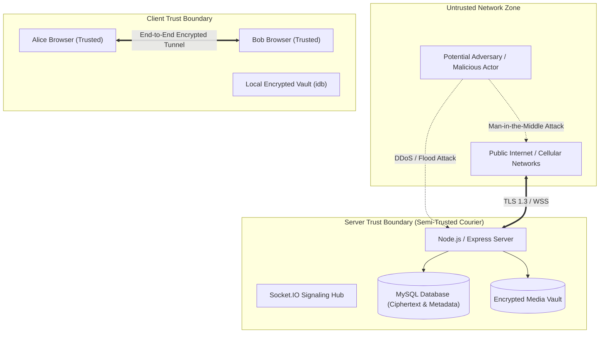

# GCS CONNECT — STRIDE Threat Model & Security Risk Analysis
**Document Version:** 1.0.0  
**Phase:** 0 — Initial Project Audit  
**Author:** Cybersecurity & Threat Modeling Lead, Global Crest Solutions  
**Date:** November 2, 2026  
**Status:** APPROVED & BASELINED  

---

## 1. Threat Modeling Scope & Trust Boundaries

The STRIDE model analyzes potential attack vectors against the **GCS CONNECT** ecosystem.

---

## 2. STRIDE Assessment Matrix

### 2.1 Spoofing (Identity Impersonation)
* **Threat S1: User Identity Spoofing:** An attacker attempts to forge credentials or session cookies to impersonate a legitimate user.
  - *Mitigation:* Passwords hashed with memory-hard **Argon2id**. Sessions managed via signed JWT in `HttpOnly`, `Secure`, `SameSite=Strict` cookies tied to an active database session record.
* **Threat S2: Cryptographic Identity Spoofing:** A malicious actor attempts to publish a fake Identity Key on behalf of Bob to intercept messages.
  - *Mitigation:* Public keys signed with the user's master Identity Key (SPK signature verification). Device fingerprinting and QR/Safety Number verification between peers.
* **Threat S3: Socket Connection Hijacking:** An unauthenticated socket joins a conversation room to eavesdrop.
  - *Mitigation:* Socket.IO authentication middleware validates session tokens on the HTTP upgrade request. Room joins require explicit database authorization against `conversation_members`.

---

### 2.2 Tampering (Data Modification)
* **Threat T1: Ciphertext Alteration in Transit:** An attacker or rogue database administrator modifies encrypted messages or attachments in MySQL.
  - *Mitigation:* **AES-256-GCM** authenticated encryption with an immutable 128-bit authentication tag. Any bit manipulation causes decryption to fail automatically with an authentication tag mismatch error (`TagMismatchError`), rejecting the packet without execution.
* **Threat T2: Prekey Bundle Tampering:** The server serves forged prekeys to initiate an eavesdropping session.
  - *Mitigation:* Signed Prekeys (SPK) are verified against the recipient's verified Identity Key signature. If signature verification fails, the client refuses session initiation.
* **Threat T3: Malicious File Upload Tampering:** An attacker uploads executable binaries (ELF, EXE, PHP) disguised as images or videos.
  - *Mitigation:* Magic-number binary header inspection via `file-type`, random UUID filenames in isolated non-executable directories, client-side encryption of raw binary before upload, and serving via strict `application/octet-stream` or verified MIME types.

---

### 2.3 Repudiation (Denial of Action)
* **Threat R1: Administrative Action Deniability:** An administrator denies creating, suspending, or deleting user accounts.
  - *Mitigation:* Immutable database `audit_logs` record admin ID, action, target user ID, IP address, user-agent, and UTC timestamp.
* **Threat R2: Message Delivery Disputes:** A sender denies sending a message or a receiver claims they never received it.
  - *Mitigation:* Cryptographic ratchet signatures prove message origin. Explicit delivery and read receipts (`message_receipts`) logged with timestamps.

---

### 2.4 Information Disclosure (Data Leakage)
* **Threat I1: Server Database Breach:** A hacker dumps the production MySQL database.
  - *Mitigation:* **Zero-Knowledge Architecture.** The database contains only base64-encoded ciphertext, salt hashes, public keys, and timestamps. Even a complete database dump reveals **zero plaintext conversation content**.
* **Threat I2: Metadata Leakage:** An observer monitors traffic to determine who is communicating with whom and at what times.
  - *Mitigation:* Transport layer encrypted via TLS 1.3. Sealed-sender routing architecture evaluated for future phases. Ephemeral socket packet headers minimized.
* **Threat I3: Memory Dump / XSS Key Extraction:** Malicious script running in browser attempts to read cryptographic keys from memory.
  - *Mitigation:* Strict Content-Security-Policy (CSP) blocking external scripts, inline evaluations (`unsafe-eval`), and unapproved origins. Key material isolated in Web Crypto `CryptoKey` non-extractable handles where supported.

---

### 2.5 Denial of Service (DoS)
* **Threat D1: Socket Flooding & Reconnect Storms:** An attacker opens thousands of concurrent WebSocket connections to exhaust server memory.
  - *Mitigation:* Socket connection rate limiting (IP-based and account-based), maximum frame size enforcement, and connection backoff limits.
* **Threat D2: One-Time Prekey Depletion:** An attacker repeatedly requests prekey bundles for Bob until his OPK pool is empty.
  - *Mitigation:* Rate limiting on prekey bundle endpoint; fallback to signed prekey with warning; automated background replenishing when OPK count drops below 20.
* **Threat D3: Storage Exhaustion via Large Uploads:** An attacker uploads massive files to exhaust Hostinger disk space.
  - *Mitigation:* Strict per-user storage quotas, max file size limits (50MB for video, 20MB for images, 10MB for documents), and automated cleanup of orphaned media.

---

### 2.6 Elevation of Privilege
* **Threat E1: Horizontal Privilege Escalation (IDOR):** User A queries `/api/conversations/{id}` for User B's conversation.
  - *Mitigation:* Every database query and Socket.IO handler validates that `req.user.id` exists in `conversation_members` for that specific `conversation_id`.
* **Threat E2: Vertical Privilege Escalation:** A regular user attempts to call `/api/admin/users/create`.
  - *Mitigation:* Backend role authorization middleware (`requireRole('ADMIN')`) rejects non-admin users with HTTP 403 Forbidden before executing any logic.
* **Threat E3: Administrator Impersonation of User:** An admin resets a user password and attempts to read their messages.
  - *Mitigation:* Resetting a password does **not** grant access to the user's device-held private keys or existing Double Ratchet sessions. The admin cannot read historical encrypted messages.
